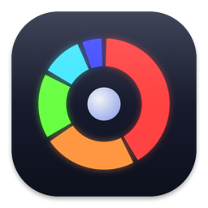
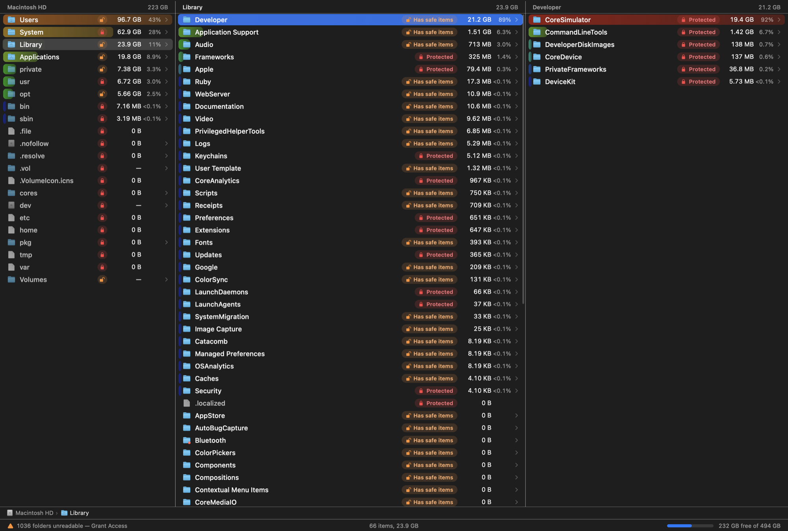
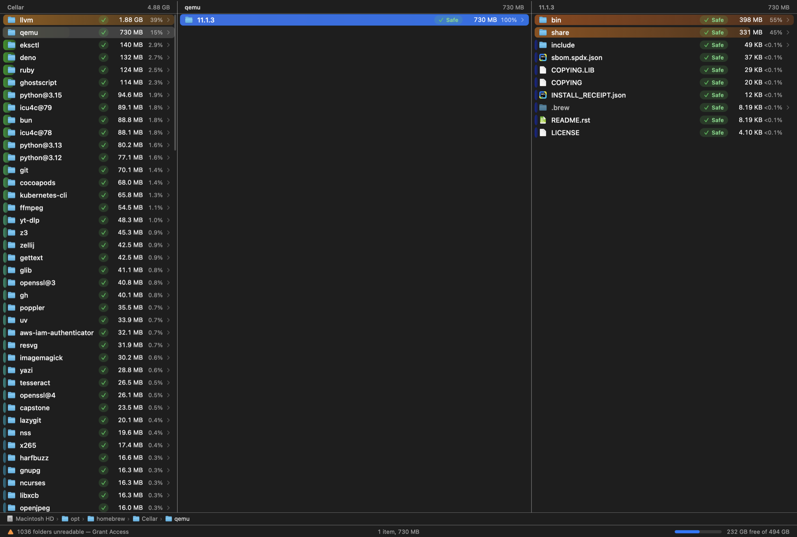

<p align="center"></p>

<h1 align="center">SpaceMaster</h1>

<p align="center">
A very fast, native disk-space manager for macOS on Apple Silicon.<br>
See at a glance which folders eat your disk, and delete them safely.
</p>



## Features

- **Instant sizes.** A multi-threaded scanner built on `getattrlistbulk(2)` measures folders at 250–370k items per second.
  Sizes update live while scanning, and the folder you open is always scanned first.
  (A 104 GB home folder with 766k items scans in ~6 s, `du` needs ~24 s.)
- **Colored share bars.** Every row has a bar behind it: its length is the size relative to the biggest sibling and its color goes from
  red (huge share of the folder) through green to blue (tiny). The biggest space hogs jump out immediately.
- **Safety badges.** Each item tells you whether removing it is a good idea:

  | Badge | Meaning |
  |---|---|
  | 🟢 **Safe** | Deleting it won't hurt macOS or your account. Whether the *content* matters is your call. |
  | 🔴 **Protected** | System files, SIP-locked items, folders you have no permission for, and sensitive folders (Keychains, `.ssh`, …). Can't be deleted from the app. |
  | 🟠 **Has safe items** | The folder itself is protected (e.g. `~/Library`, `Documents`, `/Applications`) but it contains things you *can* delete, so you don't have to hunt through every subfolder. |

  Hover a badge for the reason.
- **Finder-like navigation.** Three Miller columns (parent | current | preview of the selected folder), a native sidebar with your
  drives and their usage, a clickable path bar, cursor memory per folder and a filter field. Fully keyboard driven (vim keys,
  like [FileMaster](https://github.com/cembaylam/FileMaster)), and mouse friendly too.
- **Safe deleting.** *Move to Trash* (undo with ⌘Z) or *Delete Immediately* (confirmation, frees space right away). Multi-select with
  Space / Tab / ⌘-click and see how many bytes you are about to free.
- Native AppKit, Apple Silicon only, light and dark mode.



## Install

1. Download `SpaceMaster-1.0.0.dmg` from the [latest release](../../releases/latest) and drag **SpaceMaster** to *Applications*.
2. The build is ad-hoc signed (no Apple Developer ID), so macOS may block the first launch. Run once:
   ```sh
   xattr -dr com.apple.quarantine /Applications/SpaceMaster.app
   ```
3. Recommended: grant **Full Disk Access** (System Settings → Privacy & Security → Full Disk Access). Without it macOS hides some
   protected folders, and each refused folder costs a few milliseconds, which slows scans. The status bar shows a *Grant Access* link when it matters.

Requires macOS 27 or later on Apple Silicon.

## Keyboard

| Keys | Action |
|---|---|
| `j` `k` / `↑` `↓` | move cursor |
| `h` `←` / `l` `→` | parent / enter folder |
| `gg` `G` · `⌃d` `⌃u` | top / bottom · half page |
| `H` `L` (`⌘[` `⌘]`) | history back / forward |
| `Return` `o` | open file (folders: enter) |
| `Space` `Tab` · `v` · `⌘A` | select + next · select all |
| `d` `⌫` | move to Trash (`⌘Z` undo) |
| `D` `⌘⌥⌫` | delete immediately |
| `.` | show / hide hidden files |
| `,s` `,n` `,m` | sort by size / name / date (capital letter reverses) |
| `gh` `gd` `gD` `gc` `ga` `gl` `gr` `gt` | Home, Downloads, Desktop, Documents, Applications, Library, `/`, Trash |
| `g␣` `⌘⇧G` | go to path |
| `/` `f` `⌘F` | filter the current folder |
| `r` | rescan the folder under the cursor |
| `y` · `R` | copy path · reveal in Finder |

`⌘/` shows the same list inside the app.

## Build from source

Requires Xcode 27 / Swift 6.4.

```sh
make run     # debug build, launches the app
make test    # unit tests
make bench DIR=~    # scanner benchmark
make dist    # release build, signed app and DMG in dist/
```

`make dist` signs with a Developer ID certificate and notarizes when `SIGN_ID` / `NOTARY_PROFILE` are set (see `scripts/package.sh`);
otherwise it falls back to ad-hoc signing.

## How it works

- **`SMCore`** (no AppKit): `DirEnumerator` bulk-reads directories. `SizeScanner` runs worker threads over a LIFO stack, adds each folder's
  file bytes to it and all ancestors with atomic adds, and the UI reads those atomics at 12 Hz for live sizes. Only directories are
  kept in memory (files are summed, then re-listed when a folder is shown), so memory scales with the number of folders.
  `SafetyClassifier` holds the Safe / Protected rules.
- **`SMApp`** (AppKit): custom-drawn lists (fixed row height, only visible rows drawn, cached text and icons), so scrolling and
  cursor moves stay instant even in folders with tens of thousands of entries.

## Notes and limits

- Sizes are *allocated* bytes. APFS clones and hard links are counted once per path, so totals can slightly exceed real usage.
- The Trash doesn't free space until emptied. Use *Delete Immediately* for that.
- The Safe badge is about system safety only. Always check that you don't need the contents.

## License

MIT. See [LICENSE](LICENSE).
